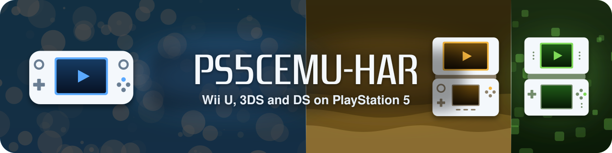

  

  
  
  
  
  
  

  <b>PS5CEMU-HAR</b> plays your Wii U, Nintendo 3DS and Nintendo DS games on a jailbroken PS5, 
  with <a href="https://github.com/cemu-project/Cemu">Cemu</a>, <a href="https://github.com/azahar-emu/azahar">Azahar</a>
  and <a href="https://github.com/melonDS-emu/melonDS">melonDS</a> in one launcher made for the TV and the DualSense.

  <a href="https://github.com/premohq/PS5CEMU-HAR/raw/releases/PS5CEMU-HAR-v4.0.2.zip"><b>Download 4.0.2</b></a> (ZIP, 52.5 MB) ·
  <a href="https://github.com/premohq/PS5CEMU-HAR/releases/tag/v4.0.2">Release notes</a> ·
  <a href="#install">Install</a> ·
  <a href="docs/GUIDE.md">Guide</a> ·
  <a href="docs/COMPATIBILITY.md">Compatibility</a> ·
  <a href="#credits">Credits</a>

---

## What's new in 4.0.2

Fixes for 4.0.1, and a few things you asked for. The details are in the [release notes](https://github.com/premohq/PS5CEMU-HAR/releases/tag/v4.0.2).

- **3DS games save again, and installed games can be deleted** ([#55](https://github.com/premohq/PS5CEMU-HAR/issues/55), [#56](https://github.com/premohq/PS5CEMU-HAR/issues/56), [#58](https://github.com/premohq/PS5CEMU-HAR/issues/58)): every file and
  folder the app makes is open to every user, so a game whose saves or shader cache could not be
  written no longer starts to black screens, and an FTP client or a file manager can delete installed
  CIAs. Files an older version made are opened as the app starts.
- **Artic Setup needs no keys from you** ([#45](https://github.com/premohq/PS5CEMU-HAR/issues/45)): Azahar's own are built in, as in its official
  builds. **Artic Base connects** on consoles where it failed the moment it started (thanks, dolphin78).
- **Quit to the library** comes back to the library from Wii U and 3DS games, instead of closing the app
  ([#60](https://github.com/premohq/PS5CEMU-HAR/issues/60)).
- **An encrypted 3DS game** is refused in the launcher, which says why, instead of closing the app
  ([#57](https://github.com/premohq/PS5CEMU-HAR/issues/57)).
- **Games in archives** ([#50](https://github.com/premohq/PS5CEMU-HAR/issues/50)): `.zip`, `.7z`, `.rar` and tar archives are in the library on
  every side, by their games' own names and icons. DS games play without extracting them; a Wii U or
  3DS game is unpacked once, the first time it starts, and the copy is kept for the next (**Settings >
  Diagnostics > Unpacked games** clears them; [how](docs/GUIDE.md#games-in-archives)).
- **New buttons** in **Settings > Controls**: *Touch at the cursor* (3DS and DS, for drawing), *Fast
  forward* (3DS and DS) and *Rewind* (DS) ([#59](https://github.com/premohq/PS5CEMU-HAR/issues/59), [#54](https://github.com/premohq/PS5CEMU-HAR/issues/54)).
- **Everything on the app's drive:** installed on a USB drive or the extended storage, the app can keep
  its data there instead of in `/data` ([#52](https://github.com/premohq/PS5CEMU-HAR/issues/52), [how](docs/GUIDE.md#everything-on-the-apps-drive)).
- **Keyboards** have each language's letters, such as Spanish *ñ* ([#51](https://github.com/premohq/PS5CEMU-HAR/issues/51)), and a Wii U or 3DS game
  whose server hangs up no longer closes the app.
- **Every side alike:** the DS side's messages are in your language as the others' are, a DS game that
  does not start says why in the same way, and the 3DS and DS performance overlay is in Settings too.

Changes in earlier versions are in their [release notes](https://github.com/premohq/PS5CEMU-HAR/releases).

## Features

| | Wii U | Nintendo 3DS | Nintendo DS |
|---|---|---|---|
| **Emulator** | Cemu, x64 recompiler, Vulkan | Azahar, dynarmic recompiler, Vulkan | melonDS, ARM recompiler |
| **Plays** | `.wua`, `.wud`, `.wux`, unpacked games (also in `.zip`, `.7z` and `.rar` archives) | `.3ds`, `.cci`, `.cxi`, `.app`, `.3dsx`, `.elf`, compressed `.z*`, also in `.zip`, `.7z` and `.rar` archives; installed `.cia` | `.nds`, also in `.zip`, `.7z` and `.rar` archives |
| **Picture** | 4K output, 120 Hz, FSR 1, graphic packs | up to 10x resolution, texture filters, layouts, borders | sharp, smooth or square pixels, layouts, borders |
| **Extras** | mods, accounts, amiibo, Skylanders portals, updates and DLC | save states, cheats, amiibo, mods, Artic Base | save states, cheats, RetroAchievements |

- **One launcher for all three:** box art and game info from GameTDB, search, sorting and favourites,
  a page for each game, settings for each game, and an in-game menu on every system.
- **Made for the DualSense:** every button remappable, motion controls, rumble, the touchpad as the
  touch screen, and up to four players on the Wii U.
- **Updates itself:** a new release installs from inside the app.

## Install

1. **A PS5 that runs homebrew.** Any firmware up to 13.60, with etaHEN, OnionHEN, or an ELF loader on
   port 9021. See the [firmware and setup guide](docs/HEN-SETUP.md).
2. **Copy the app.** Download the [latest ZIP](https://github.com/premohq/PS5CEMU-HAR/raw/releases/PS5CEMU-HAR-v4.0.2.zip),
   extract it and copy the `PPSA99360` folder to `/data/homebrew/PPSA99360`.
3. **Let your HEN in.** etaHEN: add `PPSA99360` to its app jailbreak list. OnionHEN: add `PPSA99360`
   at the end of `exact_title_ids` in `config.ini`, with no comma after it. Any other: have an ELF
   loader on port 9021.
4. **Add your games** (below), and start PS5CEMU-HAR from the home screen. The Setup check shows
   what's ready and what to do about the rest.

Updating: the app offers new releases itself. Everything in `/data/ps5cemu` is kept.

Installed on a USB drive or the extended storage? A `PS5CEMU-HAR-data` folder at the top of that drive
keeps everything there instead of in `/data`: [the guide](docs/GUIDE.md#everything-on-the-apps-drive)
says how.

## Your games

| | Games folder | Also needs |
|---|---|---|
| **Wii U** | `/data/ps5cemu/games` | disc keys in `/data/ps5cemu/keys.txt` for encrypted `.wud` and `.wux` |
| **3DS** | `/data/ps5cemu/azahar/games` | nothing: games must be decrypted dumps; `.cia` files install from Settings |
| **DS** | `/data/ps5cemu/melonds/games` | nothing: your own BIOS and firmware in `/data/ps5cemu/melonds/bios` are optional |

Any other folder, a USB drive or a network share works too: **Settings > Game files** on each system.
No games, Wii U disc keys or firmware are included. Use dumps of games and hardware you own.

## Controls

| | |
|---|---|
| **L1 / R1** | Library and Settings |
| **Touchpad click** | The next system |
| **Cross / Circle** | Play or open / back |
| **Options** | A game's menu: game settings, saves, graphic packs, mods, home screen tile |
| **Touchpad click + Options** | The in-game menu |
| **Touchpad** | The touch screen (GamePad, 3DS and DS) |

Every shortcut, the in-game menu and the rest are in the [guide](docs/GUIDE.md).

## Documentation

- [Guide](docs/GUIDE.md): the launcher, each system, controls, saves, mods, the remote touch screen and where files are kept
- [Firmware and setup](docs/HEN-SETUP.md) · [Mods](docs/MODS.md) · [Compatibility](docs/COMPATIBILITY.md)
- [Building from source](docs/BUILDING.md) · [Driver performance](docs/DRIVER-PERFORMANCE.md)
- Problems: **Settings > Diagnostics > Copy logs to USB**, then [open an issue](https://github.com/premohq/PS5CEMU-HAR/issues/new/choose)

## Building

`make release` on Ubuntu 24.04 (WSL works) downloads every dependency at its pinned version, builds
the three emulators and the launcher, and writes the app to `build/app/PPSA99360` and a ZIP to
`dist/`. See [docs/BUILDING.md](docs/BUILDING.md).

## Join the Discord

The server at [discord.gg/grrqkv4xWw](https://discord.gg/grrqkv4xWw) is the quickest way to get help and to hear about new versions:

- **Help with your setup:** ask in the support forum, one post per problem, tagged Wii U, 3DS or DS.
- **What runs, and how well:** tested-games has a post per game with its speed, its glitches and the settings that work.
- **New versions first:** every release is posted in announcements the moment it's published.
- **The developer and other players:** suggest features, share your setup and hear what's coming.

Bugs still go in [GitHub issues](https://github.com/premohq/PS5CEMU-HAR/issues/new/choose), with the log from *Copy logs to USB*.

## Credits

- [Cemu](https://github.com/cemu-project/Cemu) by the Cemu team and contributors (MPL-2.0)
- [Azahar](https://github.com/azahar-emu/azahar) by the Azahar team and the Citra contributors
  before them (GPL-2.0-or-later), with dynarmic by MerryMage and contributors
- [melonDS](https://github.com/melonDS-emu/melonDS) by Arisotura and the melonDS team (GPL-3.0),
  with its FreeBIOS replacements
- **Mihawk** for RADV on PS5 ([PS5_Mesa](https://github.com/mihawk-99/PS5_Mesa),
  [PS5_Vulkan](https://github.com/mihawk-99/PS5_Vulkan), the payload SDK fork and its platform layer)
  and the PS5 ports of Azahar and dynarmic ([PS5_Azahar](https://github.com/mihawk-99/PS5_Azahar)),
  with contributions from **mpereiraesaa**
- **BlackBearReloaded** for [ProsperoEden](https://github.com/blackbearreloaded/ProsperoEden), which
  the launcher's layout, artwork, Eden theme and software renderer build on, and the
  [PS5 Native App Boilerplate](https://github.com/blackbearreloaded/ps5-native-app-boilerplate) for
  the app runtime, packaging and sandbox elevation
- **heydemoura** for the [PS5 Forwarder Format](https://github.com/heydemoura/ps5-forwarder-format)
  the home screen tiles use
- **John Törnblom** for the [PS5 Payload SDK](https://github.com/ps5-payload-dev/sdk), and
  **pacbrew** for their PS5 libraries
- [libsmb2](https://github.com/sahlberg/libsmb2) and [libnfs](https://github.com/sahlberg/libnfs) by
  Ronnie Sahlberg for the network shares, and [rcheevos](https://github.com/RetroAchievements/rcheevos)
  by RetroAchievements
- **dolphin78** for the remote touch screen's idea and prototype (#38), and **3lmerx503** for the
  rumble fix (#41)
- **Swordpdf** for the etaHEN jailbreak request from PS5SX2
- **Dimok** for the Wii U Homebrew Launcher's background, and the authors of the 3DS Homebrew
  Launcher, which inspired the 3DS side's
- The [Lexend](https://github.com/googlefonts/lexend) authors for the launcher's font (SIL OFL 1.1)
- [GameTDB](https://www.gametdb.com/) for box art and game information, and the authors of the
  [Cemu community graphic packs](https://github.com/cemu-project/cemu_graphic_packs)

## License

The app's own code is GPL-3.0-or-later (see [LICENSE](LICENSE)). Files derived from Cemu keep Cemu's
MPL-2.0, as their headers say; Azahar is GPL-2.0-or-later and melonDS GPL-3.0, and the app that
includes them is distributed under GPL-3.0-or-later. Other third-party components keep their own
licenses.

PS5CEMU-HAR is an independent homebrew project, not affiliated with or endorsed by Sony Interactive
Entertainment, Nintendo, or the Cemu, Azahar or melonDS projects. "PlayStation" and "PS5" are
trademarks of Sony Interactive Entertainment Inc.; "Wii U", "Nintendo 3DS" and "Nintendo DS" are
trademarks of Nintendo. No firmware, keys, games or SDK material is included. It is provided as is,
without warranty, for use with hardware and games you own.

## Support

PS5CEMU-HAR is free. If it brings your games back, you can support it at
[paypal.me/empthe](https://www.paypal.com/paypalme/empthe), or scan the code (the same one as in the
app's **Settings > About**):

